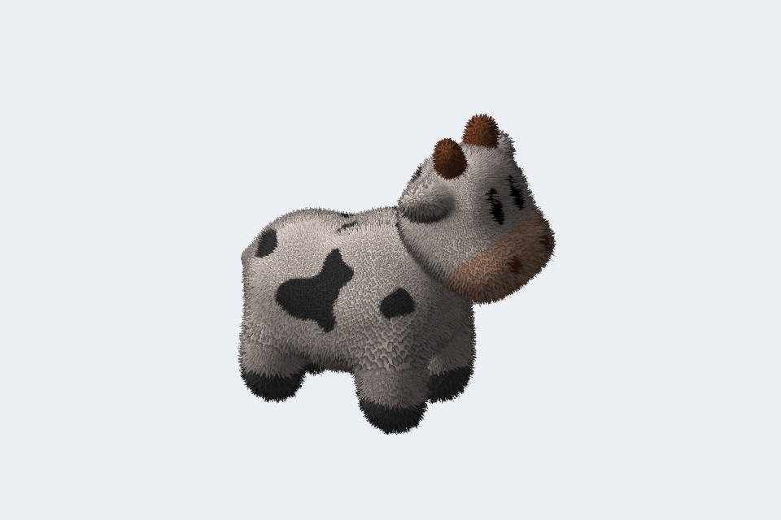

# nt3d

A small 3D scene engine for Go programs that draw in the terminal or the browser.

Build a scene of meshes, points, lines, and textures, point a camera at it, and nt3d renders it: on the GPU with WebGPU, in software when there's no GPU, or as wireframe text when there are no graphics at all. A [Bubble Tea](https://github.com/charmbracelet/bubbletea) widget puts it in your terminal app, with mouse orbiting, picking, and Kitty graphics.



```sh
go get nimbleterminal.dev/nt3d@latest
```

```go
scene := nt3d.NewScene()
ball, _ := nt3d.BuildSphere(nt3d.Sphere{Radius: .6, Color: orange})
scene.SetGeometry("ball", ball)

view := nt3dwidget.New(scene, 80, 24) // a Bubble Tea model you can drag to orbit
```

## What's inside

- A scene graph with transforms, visibility, and shared, instanced geometry
- WebGPU, software, and wireframe renderers that draw the same picture
- Textures with mipmaps, transparency, cutouts, highlights, shadows, fog, shader textures, and fur
- STL, OBJ, 3MF, PLY, and glTF files, read within memory and size limits
- A Bubble Tea widget that falls back gracefully when the GPU or terminal can't keep up

## Learn more

The **[guide](https://nimbleterminal.github.io/nt3d/docs/)** covers it all, from a first program to scenes, materials, mesh files, rendering, and the widget, and the **[gallery](https://nimbleterminal.github.io/nt3d/)** runs every demo in your browser. The guide's source is in [`docs/hugo`](docs/hugo/content/guide/); `task docs:hugo:serve` serves it locally (needs [Hugo](https://gohugo.io/) extended and `git submodule update --init`).

To run the demos yourself:

```sh
task fur         # or terrain, shapes, models, large, mipmaps, forest, lights, particles, dynamic, procedural
task build-web && task serve   # all of them in a browser, at http://localhost:8768
```

To work on nt3d itself, see [Development](docs/hugo/content/guide/development.md) and the [roadmap](ROADMAP.md).

## License and attribution

nt3d is released under the [MIT License](LICENSE.txt), copyright © 2026 Neomantra Corp.

It was extracted from [ntcharts3d](https://github.com/NimbleMarkets/ntcharts3d), and builds on [ntpicture](https://github.com/NimbleTerminal/ntpicture), [ntgpuimage](https://github.com/NimbleTerminal/ntgpuimage), [ntcanvas](https://github.com/NimbleTerminal/ntcanvas), [Bubble Tea](https://github.com/charmbracelet/bubbletea), [gogpu/wgpu](https://github.com/gogpu/wgpu), and [qmuntal/gltf](https://github.com/qmuntal/gltf). The browser demos run on [go-booba](https://github.com/NimbleMarkets/go-booba).

The fur demo uses **Spot** the cow, by [Keenan Crane](https://www.cs.cmu.edu/~kmcrane/Projects/ModelRepository/), released into the public domain; see [spot_README.txt](examples/demos/internal/demo/models/spot_README.txt). The other sample models are generated by nt3d itself.

The guide uses the [hugo-book](https://github.com/alex-shpak/hugo-book) theme (MIT) and the [Open Sans](https://fonts.google.com/specimen/Open+Sans) fonts ([SIL Open Font License](docs/hugo/static/fonts/OFL.txt)).
