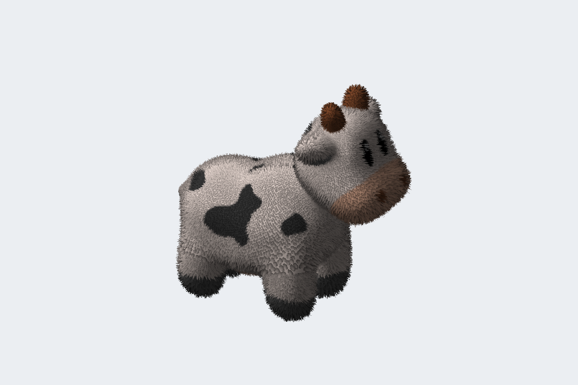

# nt3d — 3D scenes for Bubble Tea and the browser

<p>
    <a href="https://nimbleterminal.github.io/nt3d/"></a>
    <a href="https://nimbleterminal.github.io/nt3d/docs/"></a>
    <a href="https://github.com/NimbleTerminal/nt3d/tags"></a>
    <a href="https://pkg.go.dev/nimbleterminal.dev/nt3d"></a>
    <a href="https://github.com/NimbleTerminal/nt3d/actions/workflows/go.yml"></a>
    <a href="./LICENSE.txt"></a>
    <a href="./CODE_OF_CONDUCT.md"></a>
</p>

A small 3D scene engine for Go programs that draw in the terminal, the browser, or a native GPU window.

Build a scene of meshes, points, lines, Gaussians, and textures, point a camera at it, and `nt3d` renders it: on the GPU with WebGPU, in software when there is no GPU, or as wireframe text when there are no graphics at all. A [Bubble Tea](https://github.com/charmbracelet/bubbletea) widget puts it in your terminal app with mouse orbiting, picking, Kitty graphics, and half-block fallback—or `GPUSession` draws straight into a host WebGPU window.

**[Try the live browser demos →](https://nimbleterminal.github.io/nt3d/)** · **[Read the user guide →](https://nimbleterminal.github.io/nt3d/docs/)** · **[Getting started](https://nimbleterminal.github.io/nt3d/docs/guide/getting-started/)** · **[Go reference](https://pkg.go.dev/nimbleterminal.dev/nt3d)**

<p>
  <a href="https://nimbleterminal.github.io/nt3d/"></a>
</p>

## Quickstart

```sh
go get nimbleterminal.dev/nt3d@latest
```

Requires Go 1.26 or later.

```go
scene := nt3d.NewScene()
ball, _ := nt3d.BuildSphere(nt3d.Sphere{Radius: .6, Color: orange})
scene.SetGeometry("ball", ball)

view := nt3dwidget.New(scene, 80, 24) // a Bubble Tea model you can drag to orbit
```

See [Getting started](https://nimbleterminal.github.io/nt3d/docs/guide/getting-started/) for a complete runnable Bubble Tea program, or [Rendering](https://nimbleterminal.github.io/nt3d/docs/guide/rendering/) and [`examples/gogpu`](./examples/gogpu) to render offscreen frames or drive a native WebGPU swapchain.

## What's inside

- **Scene graph, dynamic meshes & level of detail** — Named nodes with parent transforms, `float64` camera-relative world origins (`Scene.SetNodeOrigin` / `Camera.Origin`) for jitter-free geographic-scale scenes, visibility, instanced shared geometry, zero-reallocation in-place vertex updates (`Scene.SetNodeVertices` / `UpdateNodeVertices`), subtree `Scene.ApplyMaterial` and `Scene.SetMaterialVariant`, distance-tiered `Scene.SetLOD` (plus multi-LOD `.glb` / multi-file `SceneAsset.WithLOD`, `Model.LODAsset`, and `CombineLOD` helpers) with `O(1)` frame-budget `SetLODBias` and `SetLODHysteresis`, and per-frame `Frame.Stats` counters (including per-tier `LODTierInstances`).
- **Declarative camera paths** — Pure `float64`, zero-allocation camera trajectories (`nt3d/cam` and YAML/JSON `nt3d/cam/spec`) with arc-length-parameterized Catmull-Rom, Bézier, and B-spline curves, Bishop parallel-transport tangent steering, `C¹` SQUAD orientation, causal look crossfades, camera switching, and 3D frustum/spline debug overlays (`AppendCameraPathOverlay`).
- **One scene, three renderers** — WebGPU, software, and wireframe renderers that draw the same picture, plus `GPUSession` / `GPUTarget` to render directly into a host window's WebGPU swapchain or sub-viewport without CPU readback.
- **Materials, lighting & effects** — Unified `Material` with Cook-Torrance GGX metallic/roughness PBR (`PBR.Metallic`, `PBR.Roughness`, `PBR.IOR`, `PBR.Specular.Color` / `PBR.Specular.Intensity`, `PBR.Clearcoat.Amount` / `PBR.Clearcoat.Roughness`, Charlie cloth `PBR.Sheen.Color` / `PBR.Sheen.Roughness`, packed linear `PBR.ORMMap`, and HDR `Emission.Color` / `Emission.Map`) alongside classic Blinn-Phong, mipmapped and anisotropic textures, normal maps, transparency with optional Weighted Blended Order-Independent Transparency (`Frame.OIT`), cutouts, scene transmission/refraction, directional, point, and `SpotLight` lighting and shadow maps, Radiance `.hdr` (`NewHDREnvironment`) and LDR panoramas with roughness-filtered specular IBL, authored box-projected local reflection probes, external HDR irradiance lightmaps with independent UVs, and spherical-harmonics sky (`nt3d/sh`), fog, 4× WebGPU MSAA and supersampling, GPU post-processing (`Frame.PostProcess`: SSAO, HDR bloom, exposure, Reinhard/ACES tone mapping, and vignette, with tiered CPU software fallbacks), shader textures, data-driven `VertexDisplacement` and `MaterialShader` WGSL/Go hooks, shell fur (`nt3d/fur`), cel/toon shading (`ToonStyle.ShadowSoftness`) with inked silhouettes and creases (including deforming and see-through meshes), and shared Gerstner waves (`nt3d/water`) with wakes, foam, and buoyancy queries.
- **Meshes, glTF animation & 3D Gaussian splatting** — Bounded decoders for STL, OBJ, 3MF, PLY, glTF/GLB (PBR materials, ORM/emissive maps, pure-Go `KHR_texture_basisu` KTX2 BasisLZ/UASTC, `KHR_mesh_quantization`, and `EXT_meshopt_compression`, `EXT_texture_webp`, `EXT_mesh_gpu_instancing`, `KHR_materials_variants`, automatic `SharedGeometry` asset deduplication, `KHR_lights_punctual`, `KHR_materials_specular` / `clearcoat` / `sheen` / `emissive_strength` / `ior` / `transmission` / `volume`, joints, morph targets, cameras, transform tracks), and 3DGS splats (`.ply`, `.spz`, `.sog`) with degree-3 spherical harmonics.
- **Clustering & spatial indexing** — `nt3d/clod` clusters large point clouds, instances, and labels once and selects visible clusters per frame on CPU or WebGPU compute; `nt3d/aabbtree` provides a standalone generic dynamic AABB tree (`Tree[T]`) with overlap and ray-cast queries.
- **Bubble Tea widget** — `nt3d/widget` handles orbit/pan/zoom input, background-indexed picking, world-anchored labels, Kitty graphics via [`ntpicture`](https://github.com/NimbleTerminal/ntpicture), and graceful fallback when the GPU or terminal can't keep up.

### Packages

| Import path | Package | Purpose |
| :--- | :--- | :--- |
| [`nimbleterminal.dev/nt3d`](https://pkg.go.dev/nimbleterminal.dev/nt3d) | `nt3d` | Core scene graph, camera, shapes, materials, lighting, animation, and GPU/software/wireframe renderers |
| [`nimbleterminal.dev/nt3d/widget`](https://pkg.go.dev/nimbleterminal.dev/nt3d/widget) | `nt3dwidget` | Interactive Bubble Tea v2 viewport with camera controls, picking, labels, and automatic renderer fallback |
| [`nimbleterminal.dev/nt3d/cam`](https://pkg.go.dev/nimbleterminal.dev/nt3d/cam) | `nt3dcam` | Pure `float64`, zero-allocation declarative camera paths, switchers, and spatial framing (`cam/spec`, `cam/curve`, `cam/frames`, `cam/ease`) |
| [`nimbleterminal.dev/nt3d/mesh`](https://pkg.go.dev/nimbleterminal.dev/nt3d/mesh) | `nt3dmesh` | Bounded STL, OBJ, 3MF, and PLY decoders (`mesh/gltf`, `mesh/spz`, `mesh/sog`, and `mesh/formats` add glTF/GLB and compressed Gaussian splats) |
| [`nimbleterminal.dev/nt3d/water`](https://pkg.go.dev/nimbleterminal.dev/nt3d/water) | `nt3dwater` | Analytic Gerstner wave surfaces, wake impulses, tiled water meshes, and Archimedes hull buoyancy/drag/planing forces |
| [`nimbleterminal.dev/nt3d/fur`](https://pkg.go.dev/nimbleterminal.dev/nt3d/fur) | `nt3dfur` | Shell-fur layers, wind/gravity sway transforms, and edge-on silhouette fins for triangle meshes |
| [`nimbleterminal.dev/nt3d/clod`](https://pkg.go.dev/nimbleterminal.dev/nt3d/clod) | `nt3dclod` | Clustered level of detail for large point clouds, instances, and label sets (CPU & WebGPU compute) |
| [`nimbleterminal.dev/nt3d/aabbtree`](https://pkg.go.dev/nimbleterminal.dev/nt3d/aabbtree) | `nt3daabbtree` | Generic dynamic AABB spatial index (`Tree[T]`) for moving boxes, overlap queries, and ray casts |
| [`nimbleterminal.dev/nt3d/sh`](https://pkg.go.dev/nimbleterminal.dev/nt3d/sh) | `nt3dsh` | Shared Go/WGSL spherical harmonics math for degree-2 diffuse skies and degree-3 Gaussian splats |
| [`nimbleterminal.dev/nt3d/math`](https://pkg.go.dev/nimbleterminal.dev/nt3d/math) | `nt3dmath` | Vectors, matrices, quaternions, rays, frustums, and bounding boxes |

## Demos

Every demo in the **[live browser gallery](https://nimbleterminal.github.io/nt3d/)** is the exact same Go Bubble Tea program you can run natively in your terminal, compiled to WebAssembly with [Booba](https://github.com/NimbleTerminal/booba). Press `1` for WebGPU, `2` for software, or `3` for wireframe in any demo.

| Browser demo | Terminal | What it shows |
| :--- | :--- | :--- |
| **[Terrain explorer ↗](https://nimbleterminal.github.io/nt3d/terrain/)** | `task terrain` | Annotated heightfield, world-anchored labels, picking, parent transforms, and shader hooks |
| **[Procedural plasma ↗](https://nimbleterminal.github.io/nt3d/procedural/)** | `task procedural` | GPU shader textures plus `VertexDisplacement` and `MaterialShader` wave hooks with Go fallbacks |
| **[Dynamic scene ↗](https://nimbleterminal.github.io/nt3d/dynamic/)** | `task dynamic` | Independently moving nodes surrounding a live-deforming wave mesh |
| **[Shape builders ↗](https://nimbleterminal.github.io/nt3d/shapes/)** | `task shapes` | Built-in primitives, flat/smooth normals, and intersecting-glass `Frame.OIT` vs sorted blending |
| **[Mesh files ↗](https://nimbleterminal.github.io/nt3d/models/)** | `task models` | Embedded STL, OBJ, and 3MF assets with components, vertex colors, and textures |
| **[Dense mesh ↗](https://nimbleterminal.github.io/nt3d/large/)** | `task large` | 735,000-triangle asteroid with background-indexed ray picking |
| **[Fur ↗](https://nimbleterminal.github.io/nt3d/fur/)** | `task fur` | Spot the cow in swaying shell fur with MSAA, post-processing, and toon ink |
| **[Mipmaps ↗](https://nimbleterminal.github.io/nt3d/mipmaps/)** | `task mipmaps` | Horizon checkerboard comparing mipmaps, anisotropic filtering, and MSAA on GPU and CPU |
| **[Forest ↗](https://nimbleterminal.github.io/nt3d/forest/)** | `task forest` | Thousands of instanced swaying trees with `Scene.SetLOD` tiers and `Frame.Stats` |
| **[Lights ↗](https://nimbleterminal.github.io/nt3d/lights/)** | `task lights` | PBR, Clearcoat & Sheen, `.hdr` IBL, spotlights, shadow maps, MSAA, and HDR post-processing |
| **[Particles ↗](https://nimbleterminal.github.io/nt3d/particles/)** | `task particles` | Up to 100,000 fire, smoke, and dust points blended additively or in depth order |
| **[glTF animation ↗](https://nimbleterminal.github.io/nt3d/animation/)** | `task animation` | Generated glTF ribbon with joints, morph targets, and transform tracks |
| **[glTF animation lab ↗](https://nimbleterminal.github.io/nt3d/animate/)** | `task animate` | Authored cameras, animated `KHR_lights_punctual` spotlights, and Khronos morph/skin/rotation samples |
| **[Gobkit characters ↗](https://nimbleterminal.github.io/nt3d/characters/)** | `task characters` | Embedded CC0 minion, corgi, and duck switching between idle, walk, and attack clips |
| **[Gaussian splatting ↗](https://nimbleterminal.github.io/nt3d/gaussians/)** | `task gaussians` | Embedded 3DGS PLY rendered as sorted, alpha-blended anisotropic ellipses |
| **[Point cloud ↗](https://nimbleterminal.github.io/nt3d/cloud/)** | `task cloud` | Million-point spiral galaxy culled and thinned per frame with `nt3d/clod` |
| **[AABB tree ↗](https://nimbleterminal.github.io/nt3d/aabb/)** | `task aabb` | Interactive `nt3d/aabbtree` spatial index showing clicked ancestor bounds |
| **[Water ↗](https://nimbleterminal.github.io/nt3d/water/)** | `task water` | Craft riding Gerstner waves with boat wakes, crest jumps, foam, spray, and reflections |
| **[Toon city ↗](https://nimbleterminal.github.io/nt3d/toon/)** | `task toon` | Cel-shaded Spot, robot, glass shelter, and cloth pennant in Manhattan with soft shadows and crease ink |
| **[Camera paths ↗](https://nimbleterminal.github.io/nt3d/campath/)** | `task campath` | Declarative YAML camera paths: banked flythrough, focal-length pull orbit, switcher, and 3D frustum rig |
| **Lighting room** | `task room` | Toggle box-projected local probes and HDR irradiance lightmaps in a cutaway room |

To run demos, inspect your own 3D files, or launch the native desktop window viewer from a local checkout (using [Go Task](https://taskfile.dev)):

```sh
task fur                         # run any gallery demo in your terminal
task meshes -- path/to/model.glb # inspect STL, OBJ, 3MF, PLY, glTF/GLB, SPZ, or SOG files
task gogpu                       # native desktop WebGPU window viewer (examples/gogpu)
task build-web && task serve     # serve the full browser gallery at http://localhost:8768
```

## User Guide

The **[nt3d User Guide](https://nimbleterminal.github.io/nt3d/docs/)** walks through every part of the engine with runnable patterns and renderer notes:

- **Start here**: [Getting started](https://nimbleterminal.github.io/nt3d/docs/guide/getting-started/) · [Scenes & LOD](https://nimbleterminal.github.io/nt3d/docs/guide/scenes/) · [Shapes](https://nimbleterminal.github.io/nt3d/docs/guide/shapes/) · [Bubble Tea widget](https://nimbleterminal.github.io/nt3d/docs/guide/widget/) · [Rendering & `GPUSession`](https://nimbleterminal.github.io/nt3d/docs/guide/rendering/)
- **Shading & effects**: [Materials & toon shading](https://nimbleterminal.github.io/nt3d/docs/guide/materials/) · [Normal maps](https://nimbleterminal.github.io/nt3d/docs/guide/normal-maps/) · [Environment & SH lighting](https://nimbleterminal.github.io/nt3d/docs/guide/environment/) · [Shell fur](https://nimbleterminal.github.io/nt3d/docs/guide/fur/) · [Water & waves](https://nimbleterminal.github.io/nt3d/docs/guide/water/)
- **Assets & motion**: [Meshes, glTF & Gaussian splats](https://nimbleterminal.github.io/nt3d/docs/guide/meshes/) · [Animation](https://nimbleterminal.github.io/nt3d/docs/guide/animation/) · [Particles](https://nimbleterminal.github.io/nt3d/docs/guide/particles/)
- **Scale & interaction**: [Clustered LOD (`clod`)](https://nimbleterminal.github.io/nt3d/docs/guide/clustering/) · [Spatial index (`aabbtree`)](https://nimbleterminal.github.io/nt3d/docs/guide/spatial-index/) · [Labels](https://nimbleterminal.github.io/nt3d/docs/guide/labels/) · [Picking](https://nimbleterminal.github.io/nt3d/docs/guide/picking/) · [Collision (`collide`)](https://nimbleterminal.github.io/nt3d/docs/guide/collision/) · [Geographic scenes (`geo`)](https://nimbleterminal.github.io/nt3d/docs/guide/geo/)
- **Demos & project docs**: [Demos guide](https://nimbleterminal.github.io/nt3d/docs/guide/demos/) · [Architecture](https://nimbleterminal.github.io/nt3d/docs/guide/architecture/) · [Development](https://nimbleterminal.github.io/nt3d/docs/guide/development/) · [CHANGELOG.md](./CHANGELOG.md) · [MIGRATION.md](./MIGRATION.md) · [ROADMAP.md](./ROADMAP.md)

The guide's Markdown source lives in [`docs/hugo/content/guide/`](./docs/hugo/content/guide/). To preview it locally, initialize the theme submodule (`git submodule update --init`) and run `task docs:hugo:serve` (requires [Hugo](https://gohugo.io/) extended).

## Open Collaboration

Run `task ci` before submitting changes. [AGENTS.md](./AGENTS.md) states the repository's rules, the [Architecture](./docs/hugo/content/guide/architecture.md) page maps the packages and files, the [Development guide](./docs/hugo/content/guide/development.md) covers GPU and fuzz testing, and [ROADMAP.md](./ROADMAP.md) lists planned work.

Contributions and feedback are welcome. Please adhere to our [Code of Conduct](./CODE_OF_CONDUCT.md).

- [Report an issue](https://github.com/NimbleTerminal/nt3d/issues)
- [Submit a pull request](https://github.com/NimbleTerminal/nt3d/pulls)

## Acknowledgements

`nt3d` was extracted from [ntcharts3d](https://github.com/NimbleMarkets/ntcharts3d) and builds on [ntpicture](https://github.com/NimbleTerminal/ntpicture), [ntgpuimage](https://github.com/NimbleTerminal/ntgpuimage), [ntcanvas](https://github.com/NimbleTerminal/ntcanvas), and [Booba](https://github.com/NimbleTerminal/booba) for the browser demos.

Thanks to [Charm](https://charm.land) for [Bubble Tea](https://github.com/charmbracelet/bubbletea) and Lip Gloss, the [GoGPU organization](https://gogpu.io) for [`gogpu/wgpu`](https://github.com/gogpu/wgpu), [qmuntal/gltf](https://github.com/qmuntal/gltf), and the [Kitty](https://sw.kovidgoyal.net/kitty/) and [Ghostty](https://ghostty.org) terminal projects.

Sample assets include **Spot** the cow by [Keenan Crane](https://www.cs.cmu.edu/~kmcrane/Projects/ModelRepository/) (public domain; see [spot_README.txt](./examples/demos/internal/demo/models/spot_README.txt)), CC0 characters from [Gobkit](https://gobkit.com/) ([SOURCES.md](./examples/demos/internal/demo/gobkit/SOURCES.md)), Khronos glTF samples in `animate`, and OpenStreetMap building data (© OpenStreetMap contributors) in `toon`. Other sample models are generated by `nt3d` itself.

The user guide uses the [hugo-book](https://github.com/alex-shpak/hugo-book) theme (MIT) and [Open Sans](https://fonts.google.com/specimen/Open+Sans) fonts ([SIL Open Font License](./docs/hugo/static/fonts/OFL.txt)).

## License

Released under the [MIT License](./LICENSE.txt).

Copyright (c) 2026 [Neomantra Corp](https://www.neomantra.com).

----
Made with :heart: and :fire: by the team behind [Nimble Terminal](https://nimbleterminal.dev).
